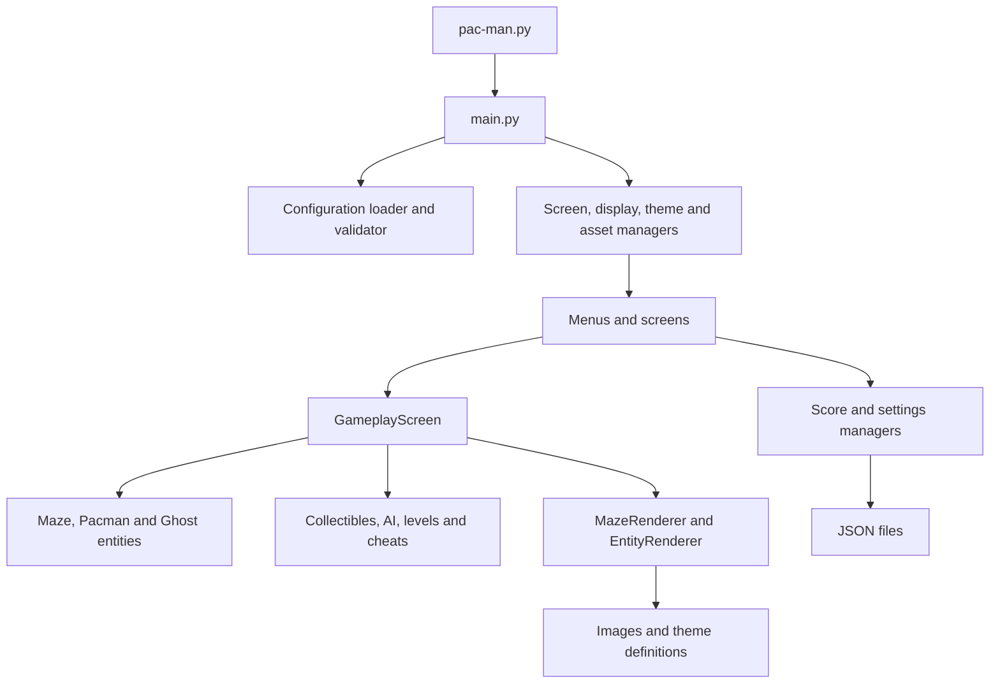
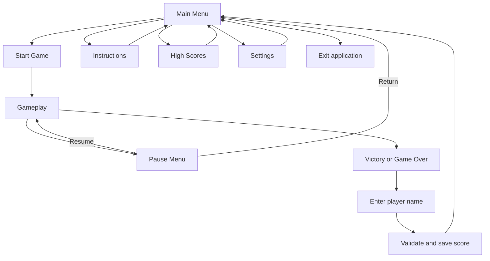
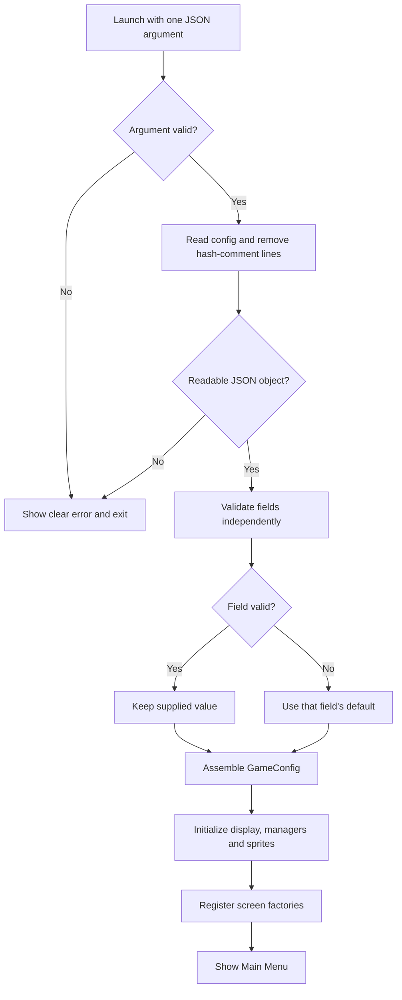
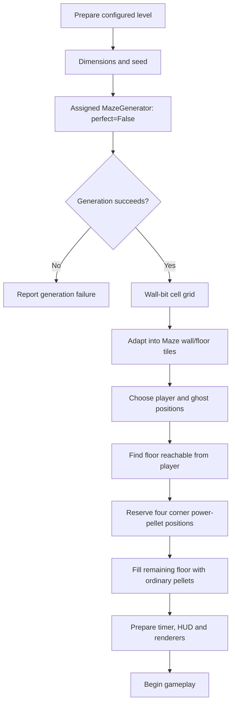
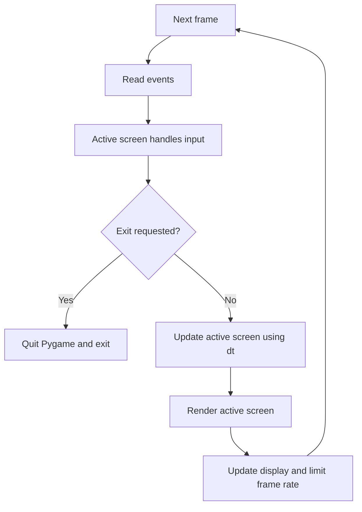
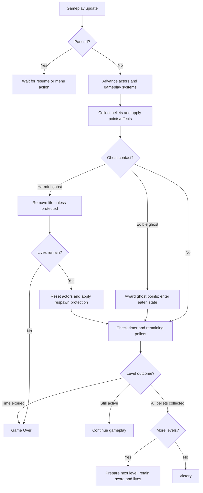
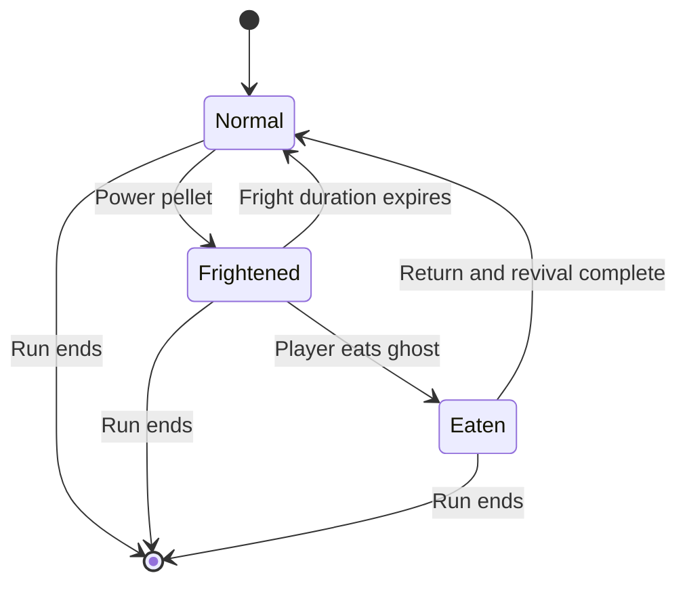
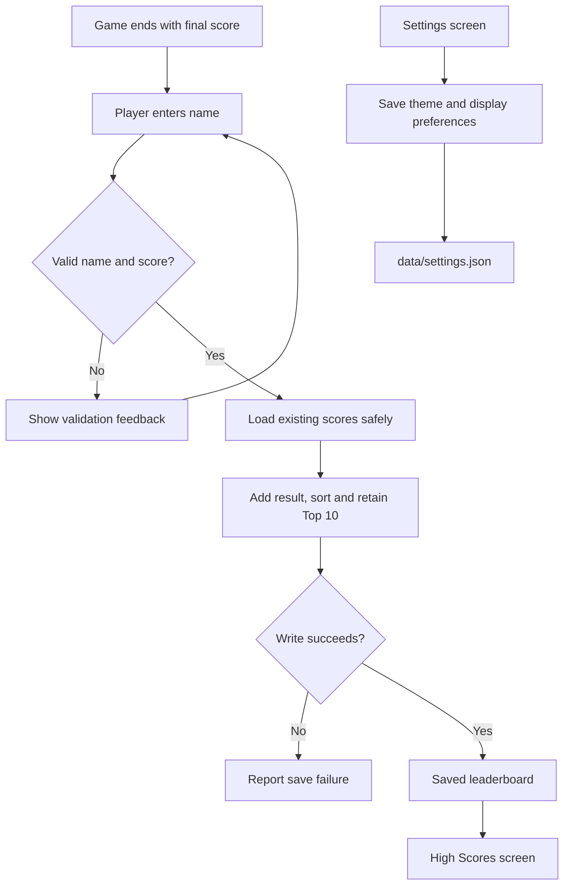
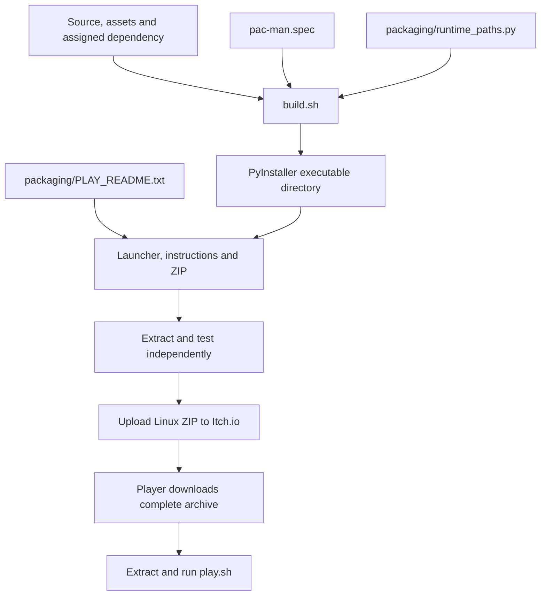

# Pac-Man — Architecture and Game Flow

This document explains the project using Mermaid diagrams. Open it on GitHub
or in a Markdown viewer with Mermaid support to see the rendered diagrams.

The diagrams describe the latest supplied project structure and discussed
updates. They are architectural documentation, not proof of a complete runtime
test or a fresh audit of every source file.

## 1. Application Architecture



`main.py` assembles components and runs the application loop. Screens handle
screen-specific input and presentation. Gameplay coordinates state and systems;
renderers display that state. Persistence is delegated to managers.

## 2. Screen Navigation



The result path represents the intended successful save flow. Save-error
recovery and additional navigation depend on the result-screen implementation.

## 3. Configuration and Startup



Unknown keys are ignored. Invalid dimensions are handled independently within
each level. Broken JSON syntax is a document-level error, not a field default.

## 4. Maze and Level Preparation



A generator maze of W × H cells expands into `(2W + 1) × (2H + 1)` movement
tiles. The external generator remains unchanged. The first maze uses the
configured seed; later-level preparation is coordinated by `LevelProgression`.

The latest pellet update uses `pacgum_count=None`, so every reachable floor tile
receives a pellet except the player start and four power-pellet positions. The
numeric `pacgum` config field does not limit placement in that mode.

## 5. Main Loop



Each screen follows the common event/update/render interface. Pausing preserves
the active run and suspends gameplay progression while pause input is handled.

## 6. Gameplay Decisions



This diagram summarizes decisions rather than the exact order of every
collision substep. The implementation collects and checks contacts in small
movement steps to reduce missed interactions. Cheat states may override normal
life-loss, speed, timing or progression behaviour.

## 7. Ghost Lifecycle



Normal ghosts pursue the player using their AI rules. Frightened ghosts are
edible and should flee. Eaten ghosts return toward home before revival.

## 8. Scores and Preferences



Score location comes from `highscore_filename`. Names have a ten-character
limit and allow alphanumeric characters and spaces; scores are non-negative
integers. The failure node does not assert a particular retry/navigation policy.

## 9. Packaging and Distribution



Build definitions stay in Git. Generated `build/` and `dist/` output should be
ignored. The build targets the operating system/architecture used to produce
it; Linux system-library compatibility still needs testing.

Game page: https://ahm5edt456.itch.io/pacman

## 10. Responsibility Map

| Contributor | Main responsibilities | Integration points |
| --- | --- | --- |
| Ahmed Alshoubaki — aalshoub | Configuration, generator integration, movement, AI, collisions, scoring, lives and levels | Maze coordinates, gameplay state and screen callbacks |
| Sadeen — sabu-kha | Screens, navigation, assets, rendering and Ice/Cosmic presentation | Screen interfaces, display geometry, themes and persistence UI |

The map describes primary responsibilities, not exclusive ownership of all code.
Both contributors need to understand how their components connect.

## Add to the Root README

```markdown
Architecture, screen transitions, gameplay and packaging diagrams are available
in [diagrams/pacman_diagrams.md](diagrams/pacman_diagrams.md).
```
